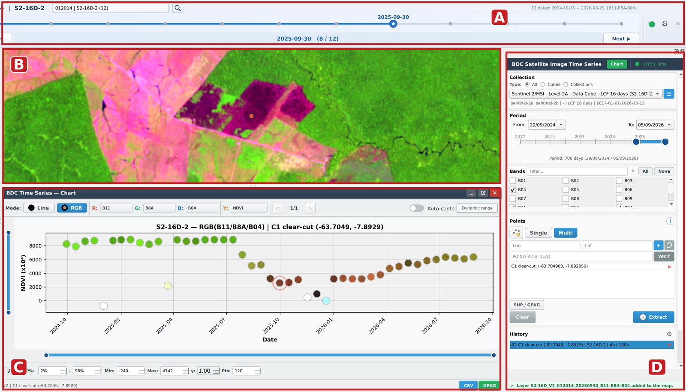
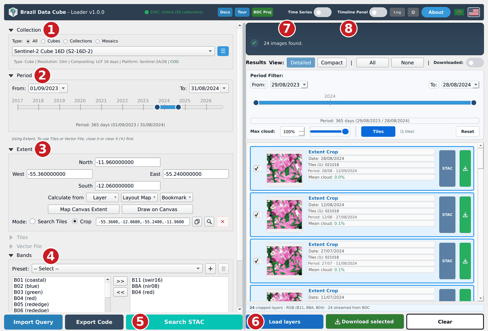
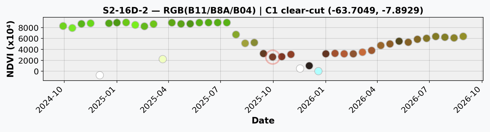

# BDC Loader

[](https://github.com/BaggioCastro/bdc-loader/actions/workflows/ci.yml)
[](https://qgis.org)
[](LICENSE)

BDC Loader is a QGIS plugin for the [Brazil Data Cube](https://data.inpe.br/bdc/) (BDC) of INPE. It searches
the BDC STAC catalog and adds the image of each date to QGIS as a layer read straight from the Cloud Optimized
GeoTIFFs, so no scene is downloaded.

It also mosaics and clips the images to your area, steps through the dates on a timeline, and draws the time
series of points next to the images.



*(A) timeline toolbar, (B) image of the selected date, (C) time series chart, (D) time series panel.*

## Install

1. Open the [latest release](https://github.com/BaggioCastro/bdc-loader/releases/latest) and download
   **`bdc_loader_plugin_v<version>.zip`**. Do not download *Source code (zip)*: QGIS cannot install it.
2. In QGIS, open **Plugins → Manage and Install Plugins… → Install from ZIP**, select the file and click
   **Install Plugin**. Answer **Yes** if QGIS asks about plugins from outside the official repository.
3. Open the plugin from the toolbar button or from **Raster → BDC Loader → BDC Loader**.

The plugin needs QGIS 3.22 or newer (QGIS 4 included) and an Internet connection to the BDC. Nothing else
has to be installed: the STAC client ships inside the plugin, and GDAL, numpy and requests come with QGIS.
The time series chart uses matplotlib; when QGIS has none, the chart area shows the command for your
system's package manager and a button that installs a compatible version for the plugin only.

## Load the images of an area



1. **Collection**: pick a cube or collection, such as *Sentinel-2 Cube 16D (S2-16D-2)*. The period and
   band lists follow the collection.
2. **Period**: drag the slider or type the dates.
3. **Area**: draw a box on the map (*Extent → Draw on Canvas*), type or click BDC tiles (*Tiles*), or open
   a polygon file (*Vector File*). In *Crop* mode each date is clipped to the area.
4. **Bands**: choose three bands for the color composite, or a preset.
5. **Search STAC** lists the dates found, with a preview and the cloud cover of each.
6. **Load layers** adds the checked dates to QGIS. Only the blocks QGIS draws are read from the BDC; no
   scene is downloaded. **Download selected** saves them as GeoTIFF instead, in BDC Albers, WGS 84 or the
   project CRS.
7. **Time Series** opens the time series panel.
8. **Timeline Panel** opens the timeline toolbar, which steps through the loaded dates with **◀ Prev** and
   **Next ▶** or with Alt+Left and Alt+Right (the keys can be changed in its settings).

**Export Code** saves the search as JSON or YAML, or writes it as Python, cURL or R code for the
[sits](https://github.com/e-sensing/sits) and rstac packages; **Import Query** reads a saved search back.

## Draw time series

In the time series panel, choose the collection, the period and the bands, click the point button and then
a place on the map (or several places in *Multi* mode), and click **Extract**. Series come from WTSS when
the BDC serves the collection there, and are read from the COGs otherwise.



In *RGB* mode each marker takes the color of the point in the composite of its date, so a cloud, a
shadow or a clearing stands out in the series. A double click on a marker opens the image of that date on
the map. The series are exported as CSV or GeoPackage.

## Other features

- Offline mode: without a connection to the BDC, **Search STAC** lists and loads the images already
  downloaded on this computer.
- Interface in English and Brazilian Portuguese, switched by the flags in the header.
- **Tour** walks through a complete case with the plugin's own buttons.
- **BDC Proj** sets the project to SIRGAS 2000 / Brazil Albers (EPSG:10857).
- **Docs** lists the BDC services and their documentation.

## BDC services used

| Service | Address |
|---|---|
| STAC API | `https://data.inpe.br/bdc/stac/v1/` |
| WTSS | `https://data.inpe.br/bdc/wtss/v4/` |
| STAC Browser | https://data.inpe.br/stac/browser/ |
| BDC data cubes | https://data.inpe.br/dados/cubos-de-dados/ |
| BDC documentation | https://brazil-data-cube.github.io/ |

## Known limitations

- Only the BDC STAC catalog is supported; other STAC servers cannot be configured.
- Images are read over the network, so loading and drawing depend on the connection to the BDC.
- Time series extraction needs the connection; offline mode covers search and loading only.

## Development

```bash
git clone https://github.com/BaggioCastro/bdc-loader.git
cd bdc-loader
pip install pytest ruff
python -m pytest            # unit suite; QGIS, Qt and GDAL are mocked
ruff check . && ruff format --check .
```

To run the plugin from the clone, copy or link `bdc_loader_plugin/` into the QGIS plugins folder
(`<profile>/python/plugins/`, opened from **Settings → User Profiles → Open Active Profile Folder**) and
restart QGIS.

`python package_plugin.py` writes `bdc_loader_plugin_v<version>.zip` with only the files QGIS needs, and
`python check_package.py <zip>` checks it against the rules of the QGIS plugin repository. The CI runs the
unit suite on Python 3.9, 3.10 and 3.13, starts the plugin in QGIS 3.22 and in QGIS 4 on Linux, Windows and
macOS, and checks the ZIP with Bandit and detect-secrets, as the QGIS plugin repository does on upload. To
release, set the version with `python bump_version.py <version>`, add its section to
[docs/CHANGELOG.md](docs/CHANGELOG.md) and push the tag `v<version>`: the release workflow builds the ZIP and
publishes it on the release page.

[docs/CONTRIBUTING.md](docs/CONTRIBUTING.md) has the code conventions and [docs/THREADING.md](docs/THREADING.md)
the threading model.

## Author

Baggio Luiz de Castro e Silva, National Institute for Space Research (INPE), São José dos Campos, Brazil.
baggio.silva@inpe.br

BDC Loader is not an official product of the Brazil Data Cube project.

## License

GNU General Public License v3.0, see [LICENSE](LICENSE). The bundled pystac 1.3.0 and pystac-client 0.3.2
are under the Apache License 2.0; their notices are in
[bdc_loader_plugin/lib/README.md](bdc_loader_plugin/lib/README.md).
